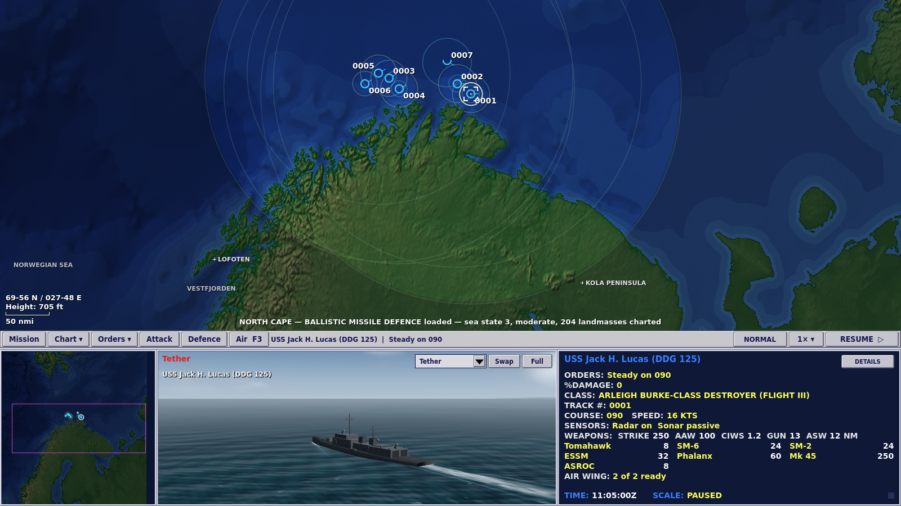

# Naval Fleet Command

Naval Fleet Command is a single-player naval command game built in Godot 4.7.2, in which you command a task force from a combat direction screen rather than steer one ship. Every contact starts as an uncertain report from radar, sonar, ESM or a lookout, and you decide what it is, where to put your ships and aircraft, and when a salvo is worth the missiles. The operations are fiction on real charts of the North Atlantic, the Western Pacific, the Gulf and the Mediterranean, set in 2027 and in 1990.

It is in the tradition of the late-1990s fleet-command games. Original art and code; no Jane's assets or affiliation.



## Play

**In the browser:** [jjnell95.github.io/naval-fleet-command](https://jjnell95.github.io/naval-fleet-command/). Nothing to install. It needs a desktop or laptop with a keyboard and a mouse or trackpad, and a browser with WebGL 2 and WebAssembly (current Chrome, Edge, Firefox and Safari). The first visit downloads the game once and the browser keeps it. A phone is told before the download that the chart is too small to read and that many orders need keys.

**Locally:** on a Mac, open **Launch Preview.command**, which serves the bundled browser build at `http://127.0.0.1:8879/`. With Godot 4.7.2 installed, run the project directly:

```sh
godot --headless --path . --import --quit    # once after cloning
godot --path .
```

The screen is laid out for 1600 × 900 or larger. The operations desk's **Options** menu scales text, labels and controls to 100%, 110% or 125%.

**First mission:** choose **Start Northern Passage** on the operations desk, read the paused briefing, then **Take Command**.

## The command loop

The screen follows the old combat direction layout: the relief-shaded tactical chart across the top two-thirds, and along the bottom the regional map, a 3D view of whatever is hooked, and the data display.

1. **Build the picture.** Contacts arrive as uncertain plots or bare bearings. Radar gives a position and a domain; ESM and sonar library matches suggest a class; a visual sighting or the operation's recognition brief gives an identity. A passive bearing has no measured range: manoeuvre, or cross it with another bearing.
2. **Decide what it is.** Right-click a contact of unknown allegiance and the hooked platforms close it until it is classified or lost. A reconnaissance aircraft can do the looking while the escorts keep station. **Designate** in a contact's menu enters it as hostile, neutral, friendly or unknown on your own judgement, and the call stands until you change it.
3. **Position.** Move, patrol, form a screen, put a combat air patrol up. A patrol, a formation slot or an air station is a standing assignment: an investigation, attack or refuelling interrupts it, and **S** sends the platform back.
4. **Engage.** Right-click a hostile and the hooked platforms close to their best weapon's range, fire, wait for the salvo to land and read the plot, and fire again until the contact is destroyed or lost, the magazines are empty or weapons are put on hold. Shift+right-click a contact for a finite salvo, a chosen weapon, a group attack under one round budget or an air strike. No missile or gun is fired on a stale plot (torpedoes, anti-radiation missiles and sites ashore may still use one), and nothing is fired with a held neutral in the seeker's basket.
5. **Defend.** Detected inbound rounds are drawn on the chart. Interceptors fire by themselves under Normal rules; under manual missile defence the area SAMs wait for **X**, while point-defence missiles and close-in guns still fire by themselves. Chaff, flares, acoustic decoys and evasion are under **Defence** in a platform's menu.
6. **Assess and reposition.** A kill is reported only on a plot with a current fix. Radio traffic runs along the bottom of the chart, and **A** opens the boards: orders, task group, track file, comms history and the battle assessment.

## Controls

**H** shows this list in the game. The board is built from the same table the command screen's bindings are tested against.

**Time**

| Keys | What it does |
|---|---|
| Space | Pause or resume |
| 1 - 6 | Time scale 1x, 2x, 5x, 10x, 30x, 60x (under Classic, 1 - 4 gives 1x, 2x, 4x, 8x) |

**Chart**

| Keys | What it does |
|---|---|
| Left-click | Hook a platform or contact; Shift adds |
| Right-click | Water: transit there. Own platform: orders. Hostile: attack. Unknown: investigate. Inbound weapon: intercept |
| Shift+right-click | Contact menu: weapons, salvos, investigate, cancel fire |
| Right-drag, arrows | Pan |
| Wheel, + / - | Zoom |
| Home / C / F | Fit force / centre / follow |
| [ / ] | Previous / next chart view |
| W | Plot a route; Shift chains waypoints |
| Shift+W | Patrol area: click two opposite corners |
| S | Return to station after a task or refuelling |
| N / Shift+N | Next / previous priority contact |
| . | Hook the next own platform |
| B | Range circle from the hooked platform |
| Tab | NTDS or graphic symbols |
| Shift+V / K / I | Velocity leaders / track numbers / tags |
| F2 / F4 / F5 / F6 | Symbol key / sensor rings / trails / relief |
| Shift+F4 | Sensor coverage shading (dark beyond your sensors) |
| L | Hooked aircraft return to deck |
| Ctrl+L / S / W | Lat-long readout / scale / radar coverage |

**3D view**

| Keys | What it does |
|---|---|
| G | Swap the chart and the 3D view |
| F10 | 3D view full screen |
| T | Cycle cameras |
| F9 / F11 / F12 / F8 | Tether / fly-by / action / detached |

**Command**

| Keys | What it does |
|---|---|
| J | Fleet Operations: task groups and fleet orders |
| D / V | Radar countermeasures / evasive manoeuvre |
| X | Engage inbound weapons with interceptors (manual missile defence) |
| Ctrl+1..9 / Alt+1..9 | Save / recall a fleet selection group |
| Shift+E / Shift+R | Weapon control / weapon ranges by role |
| R / P / E | Radar / active sonar / emission control |
| A | Status boards: orders, task group, track file, comms |
| F3 | Air operations |
| F1 | Orders and briefing; the debrief once the mission has ended |
| F7 | Reference for the selected platform or inspected contact |
| Ctrl+K | Actions, a searchable list of every command |
| M / Ctrl+E | Missions / scenario editor |
| Ctrl+F10 | Restart the mission (while it runs, asks first and autosaves it) |
| Ctrl+Shift+S / L | Quicksave / quickload |
| Ctrl+Shift+O | Saved engagements and autosaves |
| Ctrl+M | Sound on or off |
| H | The key commands board |

**Menus.** Right-click menus carry the same commands and more.

- **Your own platform:** the tasks (plot route, assign patrol area, **Return to station**, **Return to deck** for aircraft, **Flight deck**, **Ready alert**, and **Formation** with air defence screen, ASW screen, transit, screen, column, abreast and break); **Navigation** (speed, with patrol, transit and dash for aircraft; course; altitude or depth; snorkel; submarine communications; auto-return to station; clear route); **Sensors** (radar, sonar, dipping sonar, towed array, sonobuoys); **EMCON**; **Weapons state** (free, tight, hold); **Defence** (chaff, flares, acoustic decoy, evade, run away, resume plan, interceptor policy, automatic or manual countermeasures, engage inbound weapons); and **View & status**.
- **A contact:** **Attack track N**, **Identify contact**, a ready **Fire N × weapon**, **Group attack** with two or more ships hooked, **Weapon selection** (attack with a chosen weapon, engage with a finite salvo, weapon control, cancel queued fire), **Designate** (hostile, neutral, friendly or unknown) and **Air strike** against a surface or shore target. A held contact also offers aircraft from the nearest deck: fighters to intercept a hostile aircraft, a strike, or a look at something unidentified. A deck's menu offers **Air tasking**: CAP over a point, search an area, ASW search.
- **An inbound weapon:** engage it with interceptors, evade, or open the defence commands.
- **The chart with nothing hooked:** symbols and symbol controls, **Filters** (hostile, allied, neutral and unknown contacts, routes, range grid), **Chart marks** (a labelled mark, a range circle fixed on the point, a corridor between two points; they are saved with the engagement), map layers, sound (crew voice, ambient sea and machinery), **Gameplay** (the presets, each option, **Classic keys** and the interface size), the **Battle assessment** board, and every screen.
- **The 3D view:** a right-click opens the hooked platform's orders, or a contact's attack and investigate menu when it is on a contact.

**Classic keys.** **Classic keys** in the Gameplay menu (off by default, and remembered) puts a late-1990s key layout in front of the default one: **P** pauses, **T** steps the time scale, **Tab** hooks the next own platform, **B** or **L** sends hooked aircraft home, **E** arms an engage cursor, **R** and **Shift+C** set radar and emission control, the number row **1** to **9** recalls the groups saved with **Ctrl+1** to **9**, **Space** hooks the platform heard last on the radio, **Shift+1** to **3** set a third, two thirds or all of each platform's top speed, **Shift+7** to **9** set aircraft low, cruise or high and boats periscope, patrol or deep, and **Ctrl+click** or **Ctrl+right-click** zooms the chart in or out on the point. Every other key keeps its default meaning. What the layout takes those keys from (the number-key time scales, the range circle, active sonar, the camera cycle, the symbol style) stays in the right-click menus and Actions, and **H** lists the layout in use.

**Gameplay presets.** **NORMAL** has the full time ladder to 60x, automatic missile defence and ships that attack only when ordered. **CLASSIC** has an 8x ceiling, missile defence on your orders (**X**), attacks on orders, submarine communication windows, and crew voice and ambient sound on. **OPTIONS** sets each rule on its own. A saved engagement keeps the rules it was saved under.

**Saves.** The battle is autosaved every ten minutes of simulated time and the newest five autosaves are kept. A restored engagement opens paused, with the chart view, selection and 3D camera it was saved with. Leaving or restarting a running engagement asks first, and leaving, restarting or loading over one autosaves it, so Saved Engagements can bring it back.

## Missions

Eleven missions ship. The operations desk opens on **Operations**, with difficulty stars and your best result; **Training** holds the exercises; **My Missions** holds what you build with the fleet builder and the editor.

| Shelf | Mission | Year | Sea | Difficulty |
|---|---|---|---|---|
| Operations | North Cape: Ballistic Missile Defence | 2027 | Barents Sea | Advanced |
| Operations | Taiwan Strait: The Picket Line | 2027 | Western Pacific | Advanced |
| Operations | Strait of Hormuz: Tanker Transit | 2027 | Persian Gulf | Advanced |
| Operations | Eastern Mediterranean: The Tartus Line | 2027 | Mediterranean | Advanced |
| Operations | Northern Convoy | 1990 | North Sea | Introductory |
| Operations | The Iceland-Faroe Barrier | 1990 | North Atlantic | Intermediate |
| Operations | Norwegian Sea: Carrier Watch | 1990 | Norwegian Sea | Advanced |
| Training | Northern Passage | 2027 | Norwegian Sea | Introductory |
| Training | Carrier Qualification / Air Operations | 2027 | Norwegian Sea | Introductory |
| Training | Command Practice / Missile Defence | 2027 | Norwegian Sea | Introductory |
| Training | Command Practice / Deliberate Sonar | 2027 | Norwegian Sea | Introductory |

The **Campaigns** shelf takes the seven operations in order as two campaigns, **Northern Flank, September 1990** and **Four Crises, 2027**. An operation opens when the one before it has been won at 60% effectiveness or better. Nothing carries between operations.

Every mission ends with a **mission effectiveness** from 0 to 100%: the task is worth 60 (nothing on a defeat), the force you kept 20 and the enemy's losses 20, with up to 10 more for bonus tasks unless the mission was lost. Conduct is charged against that: each hit your weapons land on a neutral (a civilian incident, listed in the debrief's figures) or on your own force costs 10 whatever the damage, each neutral vessel they sink 25 more, pro rata for damage, and rounds spent far beyond what their targets were worth up to 10. A formation escort more than 1.5 nm off her station leaves a hole in the screen, and the share of the mission the screen was short costs up to 20. A mission won without an order that put the force to work (emission, rules of engagement and automation switches do not count), where there was an enemy at sea, earns only a quarter of the task. The commander's log keeps each mission's best result.

## What is modelled

The catalogues hold 140 platforms, 148 weapons and 173 sensors across the 2027 and 1990 orders of battle, each platform and weapon with a recognition model in the Reference viewer (F7). Public identities and fits are recorded in [DATA_SOURCES.md](DATA_SOURCES.md), the [2027 theatres ledger](docs/THEATRES_2027.md) and the [1990 ledger](docs/COLD_WAR_1990.md). Performance values, signatures, magazines and hit probabilities are game estimates.

- **Sensors and the plot:** radar horizons and terrain masking, ESM, passive and active sonar with a thermal layer and convergence zones, a deaf arc astern of a hull sonar, towed arrays, dipping sonar and sonobuoys, passive ranging from bearing rate, lookouts limited by the light and by cloud, and tracks that carry their uncertainty, go stale and are lost.
- **Weapons:** missiles with seekers that search a basket and can be decoyed, wire-guided heavyweight torpedoes that search about their aim point and can be decoyed, anti-radiation missiles, guns by calibre that engage ships, targets ashore and aircraft, ballistic anti-ship missiles on a single abstract profile, and one-way attack drones.
- **Defence:** layered missile defence across the force with guidance channels and shoot-look-shoot, close-in guns, chaff and flares against missiles, acoustic decoys, anti-torpedo rounds and turning away against torpedoes, and evasive steering.
- **Platforms:** ship turning by hull length and speed, routing round the coast, formation stations and screens, damage, fire and flooding, coastal and ballistic missile batteries, SAM sites and air stations ashore, and conventional submarines on a battery with a snorkel and, for two classes, an air-independent plant.
- **Aviation:** launch, recovery, fuel, deck cycles and rearming; terrain clearance; CAP, reconnaissance, ASW search and strike missions with relief; deck ready alerts.
- **The enemy:** an AI that works from its own held tracks, follows a mission plan, sizes its salvos from what its plot says of the target, answers fire and defends itself.
- **Charts:** four regions built from Natural Earth 1:10m land and bathymetry, with GMTED2010 land heights for the relief. This is generalised cartography, not navigation data.

Simplified or absent: datalink latency and topology, illumination detail, mechanical launcher conflicts, logistics and replenishment at sea, and mine warfare.

## Where to go next

- [DEVELOPING.md](DEVELOPING.md): how the code is laid out, how to run the tests and suites, and what to check before calling a change done.
- [CHANGELOG.md](CHANGELOG.md): what changed, most recent first.
- [DATA_SOURCES.md](DATA_SOURCES.md) and [assets/README.md](assets/README.md): where the catalogue's data and the art come from.

Godot's licence is in `docs/play/GODOT-LICENSE.txt`. No other source licence is granted or implied.
