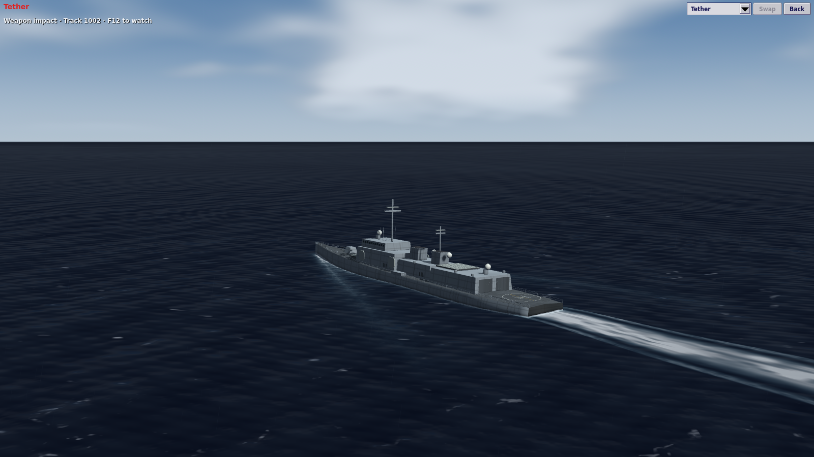
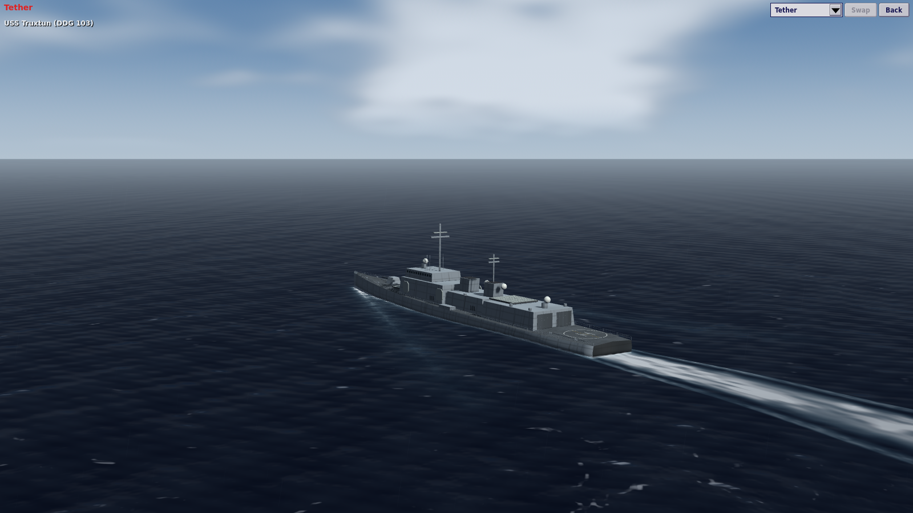
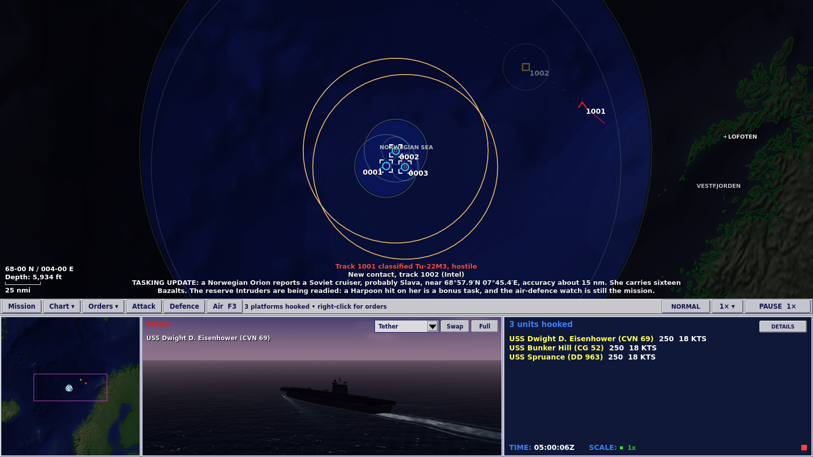

# M41: A softer horizon, a dark night and holds that fit

10 November 2026 · local development build · Godot 4.7.2

A second pass on top of [M40](2026-11-09-diesel-boats-anti-radiation-and-core-review.md): three changes to what the game looks like and three to how it behaves. Every number is a GAMEPLAY_ESTIMATE.

## Graphics

**The horizon.** The sea ended in a cut-out edge against the sky. That was deliberate (the ocean shader's own comment asked for "one dark sheet up to a crisp horizon"), and it is what made the 3D view look flat. A real sea at a grazing angle is a mirror of the sky just above the horizon, seen through miles of air. `world_ocean.gdshader` now pales the last few degrees of the sight line toward the horizon's colour (`horizon_haze`, 0.8 by default; `pow(1 - view.y, 16)`), so the near and middle sea keep their dark and the two meet in a soft line. It goes by the angle of the sight line and not by distance: a first attempt by distance changed about five rows of pixels, because from a masthead the last thirty miles are that deep. It follows the time of day through the sky's own horizon colour, and weather fog is still applied after it.

**The anti-radiation missiles' models.** M40 gave the AGM-88 the AIM-120's model as a stand-in. The art pipeline (`tools/art/build_models.py`, then `tools/art/render_assets.gd`) now builds and renders all three: the AGM-88 with its own shape in `build_ordnance.py` (a slim body, four broad mid-body wings, small tail fins), the Kh-31P and YJ-91 from the same ramjet shape as the Kh-31A. The pipeline needs `numpy`, `trimesh` and `Pillow`, and a display for the render step (`xvfb-run`).

**Long signals.** A radio line wider than the chart ran off both edges and over the position and scale readout in the corner. It now wraps between words inside the middle of the chart (`TacticalMap.wrap_radio_text`).

## Realism

**Night.** A lookout identified a ship at six miles at midnight exactly as at noon. `Simulation._update_light` now works out the sun's elevation each simulated minute from the scenario's clock and chart position (the same solar formula the 3D view already used) and sets `Detection.light`: 1.0 with the sun up, 0.0 once it is twelve degrees down. Visual identification range is multiplied by `Detection.visual_light_factor()`, which falls to 35% at night, before the weather's visibility caps it. Radar, sonar and ESM are unaffected. The value is a pure function of the minute, so a reloaded engagement gets exactly what the uninterrupted one had. An undated scenario is fought in daylight. The mission-loaded line says when it is dark and what that costs.

Carrier Watch opens at 05:00Z with the sun 2.7° down, so its lookouts start at about 85% of their daylight range and reach full range as the sun comes up.

**An inbound anti-radiation missile is named.** The alert reads ANTI-RADIATION MISSILE INBOUND, followed by one line of advice on the radio: silence and keep moving, or shoot it down.

**Holding patterns.** The standard racetrack is 3 nm wide, narrower than the turn diameter of the patrol aircraft and bombers, which M40's waypoint fix left passing its corners. `Movement.hold_size_nm` sizes the pattern to the airframe: at least 1.15 turn diameters wide at patrol speed and twice as long as it is wide. Fighters keep the standard pattern.

## Evidence

- `tests/run_tests.gd`: 1,069 tests, 0 failed. New: `tests/test_night_and_holds.gd` (5).
- `tools/test_runner_self_check.py`, `tools/verify_northern_passage.py` and `tools/verify_save_continuation.py --quick` pass; replay and save continuation are identical.
- Seventeen graphical playtests exit 0 under a virtual display: the fifteen 1280 × 720 or 1600 × 900 checks CI runs, plus the 1920 × 1080 contact-intent and Northern Passage runs.
- Screenshots above were taken from this build at 1600 × 900 under a software renderer.

## Not done

- No balance sweep, again. Night shortens identification in any operation fought in the dark.
- The 3D view still lets you watch what a lookout could see by the old daylight rule; only identification on the plot follows the sun.
- The sea's mid-distance still shows faint banding from the longest wave trains.
