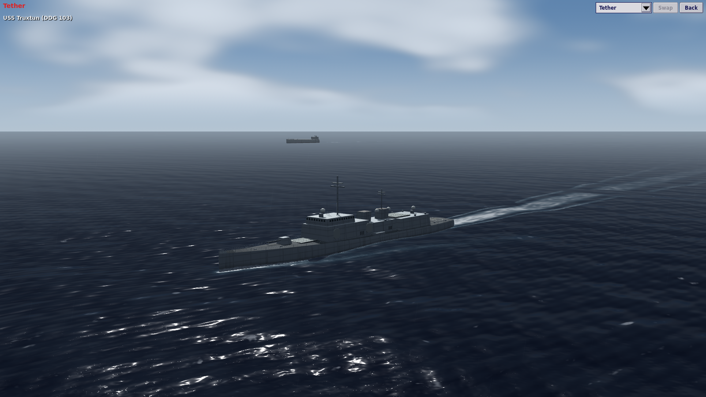
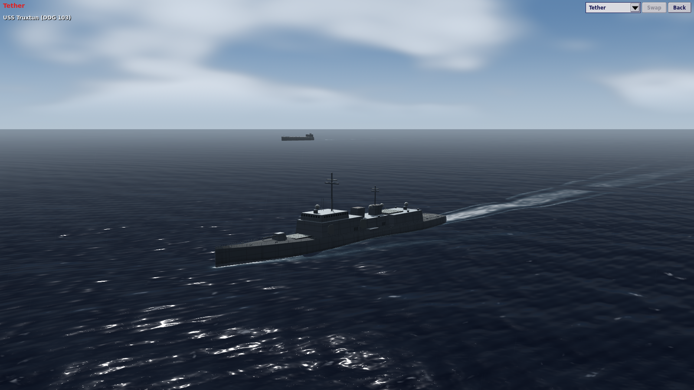
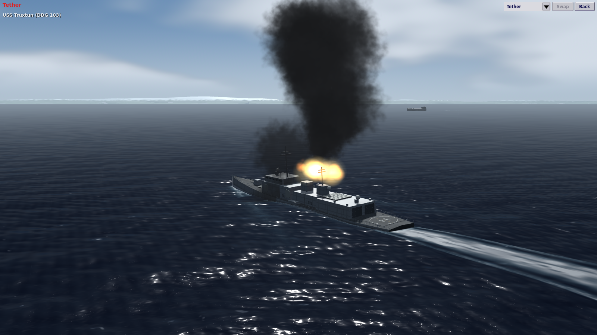
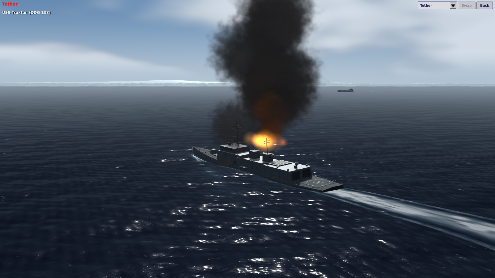
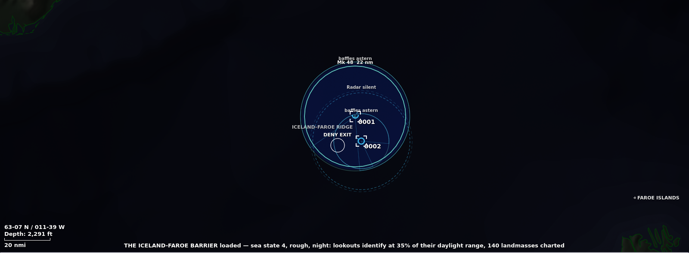

# M42: Ships against the light, fire, and the baffles

10 November 2026 · local development build · Godot 4.7.2

A third pass on top of [M40](2026-11-09-diesel-boats-anti-radiation-and-core-review.md) and [M41](2026-11-10-horizon-night-and-holds.md). The graphics changes were chosen by looking at captures of the 3D view and fixing what looked weakest; the realism change is the one piece of submarine warfare the sonar model still lacked. Every number is a GAMEPLAY_ESTIMATE.

## Graphics

**Ships against the light.** A hull's ambient light was a hemisphere that knew up from down and nothing else, so every bulkhead on the shadowed side was lit alike and a ship seen against the sun went flat grey. The sky is not one colour all the way round: it is brightest about the sun and darkest opposite. `world_hull.gdshader` now scales the hemisphere by how far a face is turned toward the sun's quarter (`SKY_AZIMUTH_CONTRAST`, 0.42), from a new global `world_sun_dir` that `WorldScene.set_time_of_day` sets. The lit side is unchanged; the shadowed side darkens and keeps its shape, and the two sides of a ship now look different. The effect fades out at night with the sun.

**Fire and smoke.** The flame particles add, and at full strength the whole fire burned out to one pale blob. The ramp is held down so the hot yellow stays at the base and the tongues above go orange and red. Oil smoke was one flat black; it is now lit from below where it leaves the fire, black in the body of the column, and thins to grey as it rises. Both are colour ramps in `world_effects.gd`; particle counts and cost are unchanged.

**The sea's middle distance.** M41 left faint bands across the sea part-way to the horizon. They were the longer wave trains, held until a pixel spanned most of a wavelength, beating against the pixel rows at a low viewing angle. Each train now fades out by half a wavelength per pixel, and the swell's slope fades with the pixel footprint as well as with distance.

## Realism: the baffles

A sonar fixed to the hull is deaf in the arc astern, where the hull and the screws lie between it and the sound. The model had no such arc: a submarine heard equally well all round, so there was no reason to turn and no good way to come at one.

- **The arc.** `Detection.baffled`: a hull-mounted sonar hears nothing, gets no ping back, and does not hear another ship's ping, within 30° of dead astern. An array streamed on a cable (towed or variable-depth) and a helicopter's dipping set are clear of it. Sonobuoys have none. Every submarine's suite in the catalogue counts as a hull set.
- **On the chart.** With the sensor layer on, a unit whose only ready sonars are hull sets shows its sonar ring open over the arc, with the two edges drawn and labelled.
- **The enemy.** An AI submarine captain on patrol or search clears his baffles: for the last 150 seconds of every fifteen minutes he swings 70° off his course, to alternate sides, then comes back. The route is not changed. A boat that is closing, shooting or running keeps its course.
- **What this gives the player.** A boat can be trailed from astern, and loses the trailer only if it turns. Your own boats have the same arc: Course, or a dogleg in the route, is how you clear it.

**Not done.** Torpedo warning is not baffled: a running torpedo is still heard from any bearing. The coverage shading under the rings is still a full disc. Player boats have no clear-baffles order of their own. Surface escorts on the AI's side do not clear theirs.

## Balance

The Hormuz check that M40 and M41 flagged as not done: `tools/opening_plans.py`, both opening plans on seeds 2 and 13, on `main` and on this branch.

| Plan | Seed | main | this branch |
|---|---|---|---|
| close_convoy | 2 | VICTORY, 94% | VICTORY, 94% |
| close_convoy | 13 | VICTORY, 86% | VICTORY, 86% |
| sweep_ahead | 2 | VICTORY, 93% | VICTORY, 95% |
| sweep_ahead | 13 | VICTORY, 86% | VICTORY, 87% |

Batteries, anti-radiation missiles, night and baffles together moved Hormuz by at most two points of effectiveness under scripted openings. The other six operations were not swept; a full sweep is about two hours on one core.

## Evidence

- `tests/run_tests.gd`: 1,073 tests, 0 failed. New: `tests/test_baffles.gd` (4). One existing fixture in `tests/test_sonar.gd` had its listener stern-on to a pinger and was turned bows-on.
- `tools/test_runner_self_check.py`, `tools/verify_northern_passage.py` and `tools/verify_save_continuation.py --quick` pass; replay and save continuation are identical.
- The fifteen 1280 × 720 or 1600 × 900 graphical playtests CI runs exit 0 under a virtual display. The 1920 × 1080 variants were left to CI.
- Captures above are from this build at 1600 × 900 under a software renderer.
