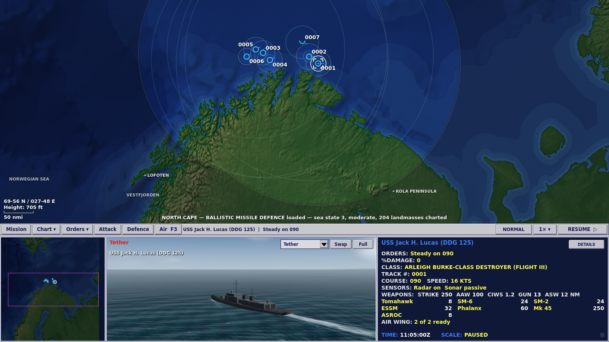
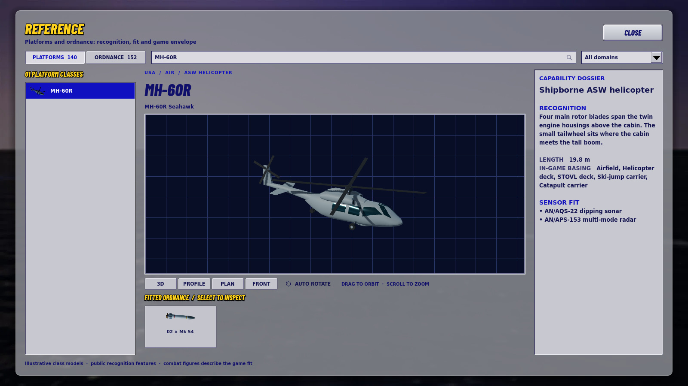

# M43: Commanding a large fleet

17 November 2026 · Godot 4.7.2 · written up 21 November

Six commits went to `main` on 17 November (`3c7ed9a` to `51bb326`) without a note. This is that note, written four days later from the diffs, the tests they added and the README they changed. It follows [M42](2026-11-10-ships-against-the-light-fire-and-baffles.md) and the two unnumbered reviews of 14 November, the [command and combat bug review](2026-11-14-command-bug-review.md) and [crew radio and sound effects](2026-11-14-audio.md).

The thread through all six is a custom fleet of forty or fifty hulls a side. At that size the chart symbols pile up, a click lands on the wrong one, a ship is hard to find, the boards cost frame time while closed, and a save drops you back at the default view. Nothing here changes a platform's performance, a weapon or an authored operation.

## Picking the right symbol

- **Stacks.** A click on overlapping symbols opens a list of callsigns and track numbers instead of taking whichever was drawn last. A symbol more than 4 px nearer the pointer than the rest is taken as a direct click (`SYMBOL_PICK_MARGIN_PX`, `CONTACT_PICK_MARGIN_PX`). The list is built from the held picture, so it cannot name a contact you do not hold. Shift adds or removes one friendly platform from the stack.
- **Inspecting keeps your shooters.** Choosing a contact from a stack, or double-clicking one in the 3D view, changes the data display and leaves the command selection alone. The 3D pick will not pass through a model or land, or reach behind the camera.
- **One primary.** A group selection has one clearly marked primary, and selected tags no longer pile on top of it.
- **Orders follow classification.** The orders panel rebuilds its weapon choices when the selected track is classified, instead of showing the list from when it was opened.

## Finding things

- **Roster search.** Task Group searches by callsign or class, including aircraft on deck. Enter selects an exact callsign or the only match. Double-clicking a row goes to that platform on the chart; for an aircraft on deck, to its ship or airfield.
- **Show on Chart.** The Track File and Air Operations jump to the report or the airborne aircraft at the current zoom. The Track File only locates a row that is still held and inside its filter.
- **Locate.** Each comms report keeps the position it was made at. Locate centres the chart there, and still works after the track has expired. A disconnected submarine's report carries its last reported position, not its true one.
- **Back and forward.** `[` returns to the chart position and scale before a jump, `]` goes forward again; sixteen steps are kept (`CHART_HISTORY_LIMIT`), and a new jump from the middle starts a new branch. Both are in the Chart menu.

## The fleet boards

- **One escort or the whole group.** A Fleet Operations row marked **1/48 selected** means orders go to that one platform; selecting the row commands the group.
- **Defence.** The Defence tab shows whether missile defence is automatic, manual or mixed across the selection, as it actually is, and **Intercept [X]** sends the order to the selected platforms.
- **Helm.** The course control opens on a heading the platform can be given and wraps through north. For a disconnected submarine it starts from the heading last reported, not the live one.
- **Flight deck.** A returning aircraft held in the marshal reads **WAITING TO LAND**, not RETURNING. One already recovering shows where it is landing, with Return & Land disabled. A host with capacity is listed even when its deck is empty.

## Destroyed contacts

`Track.confirmed_destroyed` replaces the `damage_estimate >= 100` test in the firing check, standing attacks, air missions, air defence and the AI. It is set only on a picture with a current fix: an active track that is not bearing-only and not an unverified report. A stale plot, a bearing or an intelligence report on a ship that sank unseen keeps ageing like any other contact that went quiet, so its disappearance tells you nothing. A confirmed track is held through the destruction event so the radio report has a track number, then retired without a lost-contact call. A follow-up order on it is refused with TARGET DESTROYED. On restoring an older save, only an explicit kill report comes back as confirmed.

## Custom fleets

- **Starting distance.** Fleet Builder has **Starting fleet distance**. Close is 12 nm between the forces and the widest is 140 nm (`opening_separation_nm`, along the same axis as before). A recipe without the setting starts where it always did, and seeded fleets are unchanged. Close fleets keep their clearance from each coastline.
- **Victory.** A large custom fleet's victory condition uses the opponent and threshold set in the editor. The objective line reads "31 remaining · goal 12 or fewer" when a threshold is set.

## Recognition

**F7** follows whatever the data display is showing: your own selected platform, or a contact by its held class, never the unit under the track. A reported class that several navies operate offers the entries to choose between. An unknown contact opens the catalogue with nothing selected. On the operations desk F7 opens the catalogue directly. Reference searches by short name, country or catalogue year. The model turns until you drag it or choose Profile, Plan or Front, and the angle is kept as you move between classes, so two silhouettes can be compared from the same side.

Four models were rebuilt: the MH-60R, the Tu-142, the fishing trawler and the replenishment ship Maud. Each has one GLB shared by Reference and the live view, with a matching portrait, thumbnail, profile and plan. Ten platforms gained a `recognition_note`, two sentences on what to look for. An aircraft's basing in Reference now matches what the flight deck will accept.

## The chart and the sea

Depth tints run from a brighter shelf at the coast to deep blue offshore, replacing the darker stepped bands. The chart outside every sensor's coverage is dimmed to 70% and keeps most of its colour (it was 30% and nearly grey), so land relief and depth bands stay readable there. Label callouts step out through six levels to clear each other, range and place captions share the same reservations as numbers and symbols, and a concave island no longer labels the water in its bay. The regional map's dots follow the chart's filters and use reported positions for own units.

The 3D sea is bluer and reflects twice as much of the sky (`reflect_strength` 0.22 to 0.44), with a cloud-cover term, and the short wave trains bend through the same wind patches that colour the water.

## Less work per frame

- The tactical chart redraws on a simulation tick, a pan or zoom, or an animation that needs it, and otherwise ten times a second (`IDLE_REFRESH_S`).
- The Task Group, Track File, Defence board and regional map do not rebuild while hidden; each catches up when opened.
- A long dashed leg is clipped to the chart before its dashes are laid, without shifting them.
- While paused, a ship's wake mesh and a smoke ribbon are reused until something about them changes.
- The 3D world (terrain, sky, render targets) is not built on the operations desk or the briefing. It is built once, when command is taken.

No frame times were recorded for any of this. The tests pin the behaviour, not the saving.

## Saved views

A saved engagement keeps the chart position and zoom, the command selection, the inspected contact, the 3D camera mode and the pane layout, including a swapped chart and 3D view. Detached and Fly-by keep their viewpoint when the same subject is still in the restored picture. The saved view survives the first layout pass on load, and the back-and-forward history is cleared between scenarios.

## Not done

- The balance sweep. `tools/opening_plans.py` was not run for this work, and the six operations M42 left unswept are still unswept. Two changes could move a result: the AI now reads `confirmed_destroyed` instead of a damage estimate, and an unwitnessed loss no longer retires a stale track.
- The four M42 follow-ups: baffling the torpedo warning and the coverage shading, a clear-baffles order for the player, and AI escorts that zigzag.
- A measurement of the rendering work on a large fleet, before and after.
- No source was consulted beyond the 1999 Fleet Command manual the README already cites for the class database and model viewer. `DATA_SOURCES.md` has no entry for this milestone.

## Evidence

- CI run 119 on `51bb326` passed: the unit suite and the graphical playtests. `tests/` holds 1,126 test functions by `grep`, against 1,088 at the audio merge and 1,074 at M42 (a count of functions; the runner's own total at M42 was 1,073).
- Thirty-eight tests are new, in `test_chart.gd` (9), `test_fleet_workshop.gd` (8), `test_ux.gd` (7), `test_world_view.gd` (5), `test_art.gd` (3), `test_world_fittings.gd` (2), and one each in `test_attack.gd`, `test_commander_reports.gd`, `test_readout.gd`, `test_save_migration.gd` and `test_tracking.gd`.
- `tools/fleet_command_playtest_run.gd` gained steps for comms Locate, Track File Show on Chart and restoring an inspected subject. `tools/recognition_playtest_run.gd` gained opening Reference from the chart and the library keys.
- The browser pack in `docs/play` was rebuilt in `51bb326` and deployed by Pages.
- Nothing was re-run for this note. The container it was written in has no Godot.
